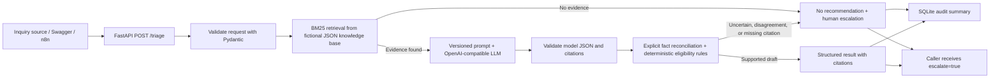

# Grant Inbox Copilot

A small portfolio project for safe, human-supervised triage of **synthetic inquiries** about a fictional grant program. It extracts facts, retrieves supporting policy snippets, validates a structured LLM draft, and escalates uncertain cases. It is not a real grant service and must not be used to make funding decisions.

## What it demonstrates

- FastAPI and strict Pydantic request/response contracts.
- A transparent rules baseline and a single OpenAI-compatible Chat Completions client (also intended for a compatible Ollama endpoint).
- Versioned system prompts (`triage-v1` through `triage-v5`) and a small BM25 retriever over a fictional JSON knowledge base.
- Explicit company-size extraction fallback, reconciled policy-missing facts, deterministic minimal citation selection from retrieved evidence, deterministic eligibility labels, escalation on missing/ambiguous evidence or a contradictory definitive model label, bounded retries, no-match escalation, and a privacy-minimizing SQLite audit trail.
- A frozen set of 50 synthetic evaluation cases and reusable classification, schema, citation, escalation, cost, and latency metrics.
- An importable n8n workflow and a Power Automate configuration walkthrough.
- An optional Streamlit front end that calls the same API and highlights citations and human escalation.

## Architecture



## Requirements

- Python 3.11 or newer.
- A Conda environment is optional. An existing environment named `grant-inbox-copilot` works well.
- A compatible LLM endpoint is required only for inquiries that match knowledge-base material. The no-match path does not call the LLM. The API key is optional for local endpoints and must be supplied through the environment, never committed.
- n8n is optional; its workflow uses `host.docker.internal` as a common Docker-to-Windows-host address. Adjust it for your deployment.

## Setup on Windows with Anaconda Prompt

Open **Anaconda Prompt**, then run these commands one at a time:

```bat
conda activate grant-inbox-copilot
cd /d C:\path\to\grant-inbox-copilot-projekt-portfolio-ai
python -m pip install -e ".[dev]"
```

The `cd /d` command moves to the project folder, including changing drives if needed. If your project is saved elsewhere, replace the path with its actual folder.

### Configure the model for this Prompt window

Set environment variables in the same Anaconda Prompt window in which you will start the API. Example for an OpenAI-compatible endpoint:

```bat
set LLM_BASE_URL=https://api.openai.com/v1
set LLM_MODEL=YOUR_MODEL_NAME
set LLM_API_KEY=YOUR_KEY
```

Replace the placeholders with values from your provider. Do not paste a real key into source code, a screenshot, or a committed file. These `set` values apply only to this terminal window. For Ollama, set `LLM_BASE_URL` to its OpenAI-compatible `/v1` base URL and `LLM_MODEL` to an installed model; leave `LLM_API_KEY` unset if your local endpoint does not require one. JSON mode support varies between models, so verify with a synthetic test first.

Optional token rates let the app estimate cost if the provider returns token usage:

```bat
set LLM_INPUT_COST_PER_1K_USD=0.00
set LLM_OUTPUT_COST_PER_1K_USD=0.00
```

Use actual rates for the selected provider/model, or leave them unset. The project does not invent prices.

### Start the API

In that same Prompt window:

```bat
python -m uvicorn app.main:app --reload
```

Leave this window open while using the API. `Application startup complete` means the server started. Open [http://127.0.0.1:8000/docs](http://127.0.0.1:8000/docs) in a browser and expand **POST /triage**.

To stop the API, focus the Prompt window and press **Ctrl+C**. If you edit a Python file while the server is running with `--reload`, Uvicorn restarts automatically; repeated restart messages during a save are expected.

## Try the demo in Swagger

1. Open `/docs`, expand **POST /triage**, and click **Try it out**.
2. Replace the request body with this synthetic, deliberately unsupported inquiry:

```json
{
  "inquiry_id": "demo-no-match-001",
  "message": "Can you fund a quantum submarine weather forecast?"
}
```

3. Click **Execute**. Because the fictional knowledge base does not support that topic, expect `200` with `result.eligibility` equal to `needs_review`, `result.recommendation` equal to `null`, an empty citations list, `result.escalate` equal to `true`, and `no_knowledge_match` in `result.escalation_reasons`. `llm.attempts` should be `0`. This verifies the safety-critical no-match behavior without using a model.
4. For an evidence-matching request, try:

```json
{
  "inquiry_id": "demo-evidence-001",
  "message": "We are a small company in North and need 50000 PLN for an R&D prototype."
}
```

The second request needs a configured LLM endpoint. It should return cited evidence or an escalated review result. Model output is not guaranteed, so use the response to inspect the guardrails rather than expecting a funding decision.

## Optional Streamlit demo

Install the UI extra in the project environment:

```bat
python -m pip install -e ".[ui]"
```

Start the API in one Prompt window, then start the UI in another:

```bat
streamlit run app/streamlit_app.py
```

The page defaults to `http://127.0.0.1:8000/triage`; set `TRIAGE_API_URL` in the UI's Prompt window to point it elsewhere. Choose one of the synthetic examples, confirm the synthetic-data checkbox, run triage, and inspect the policy citations and escalation status. Escalated inquiries are added to a local SQLite review queue at `data/review_queue.sqlite3` (override with `REVIEW_QUEUE_DB`). The queue stores the synthetic message, outcome, escalation reasons, and citations so a reviewer can inspect the case and mark it reviewed. The local queue has no access controls or retention automation. Use synthetic messages only, and do not present an `eligible` result as an award decision.

## Run tests

In a second Anaconda Prompt (or after stopping the API), activate the same environment and move to the project folder, then run:

```bat
conda activate grant-inbox-copilot
cd /d C:\path\to\grant-inbox-copilot-projekt-portfolio-ai
python -m pytest -v
```

The tests use fake LLM transports and temporary SQLite databases; they do not contact a provider or make real grant inquiries.

## Evaluation data and metrics

`data/evaluation_cases.jsonl` contains 50 synthetic inquiries with labels and expected citations. Those labels are fixed in the repository and should not be rewritten to match a model's predictions. `app.evaluation` calculates accuracy, per-class precision/recall/F1, macro F1, confusion matrix, schema validity, citation precision/recall/F1, escalation precision/recall/F1, and observed cost/latency summaries.

To run all 50 cases against the configured live API, keep Uvicorn running and use a **separate** Anaconda Prompt:

```bat
conda activate grant-inbox-copilot
cd /d C:\path\to\grant-inbox-copilot-projekt-portfolio-ai
python -m app.benchmark --output outputs\evaluation-openai-compatible.json
```

This sends one request per case; model-backed cases can incur provider charges and take time. Start with a one-case smoke run by adding `--limit 1 --output outputs\evaluation-smoke.json`; the first gold case matches the knowledge base and may call the configured LLM. Only run the full 50-case command when you are ready for those calls. The report contains all-case metrics plus `successful_response_metrics`, which scores only valid API responses so timeout/schema fallback rows do not distort model-quality metrics. It also records per-case IDs, statuses, citations, model/prompt metadata, policy-field presence, missing required fields, cost, and latency, but omits inquiry text and personal identifiers. Failed or invalid API responses are recorded visibly as invalid-schema, escalated `needs_review` fallback rows, and cause a non-zero process exit code; inspect `failure_count` before comparing runs. Unknown cost remains `null` if provider usage or configured token rates are unavailable. Run once per provider/model configuration, save each report under a distinct filename, and keep the 50 gold labels unchanged. The benchmark tests use an HTTP mock and do not call a real provider.

### Latest local Ollama run

An earlier 2026-10-20 run evaluated all 50 synthetic cases against local Ollama model `qwen2.5:3b` using prompt `triage-v5`. It had zero API failures, 100% eligibility accuracy, 100% schema validity, 100% escalation F1, and citation F1 0.982. One successful case took 52.46 seconds and used two attempts. Cost was unknown (`null`), not zero. The report is `outputs/evaluation-ollama-policy-after-timeout-fix-full.json`. The automated test suite passed with 65 tests. These results are on a small synthetic set, not evidence of real-world grant decision performance.

The latest 2026-10-20 full run after the citation changes evaluated all 50 cases. It had one API failure: case-020 returned HTTP 502 `llm_provider_error` after 94.39 seconds. The all-case metrics were accuracy 0.980, schema validity 98%, citation F1 0.993, and escalation F1 0.970. Among 49 successful API responses, accuracy, macro F1, and escalation F1 were 1.000 and citation F1 was 0.996. Their only citation mismatch was an extra funding-range citation in case-045: the broad `either ... or` amount pattern also matched a regional alternative. That pattern has since been narrowed to numeric alternatives. Mean latency across all cases was 6.35 seconds; the failed case was the long outlier. Cost is unknown (`null`). The report is `outputs/evaluation-ollama-policy-citation-fix-full.json`. The benchmark's `--timeout` controls how long its HTTP client waits for the API; Ollama's request timeout is separately controlled by `LLM_TIMEOUT_SECONDS` in the environment where Uvicorn was started.

The citation selector, explicit region fallback, and BM25 query expansion for common policy synonyms (such as `northern` → `North`, `location` → `region`, and `R&D` → `research`/`development`) were updated to address the first three mismatches. The later full report revealed the case-045 overcitation, which was fixed by narrowing the amount-alternative pattern to numeric alternatives. The live recheck of cases 039, 043, 047, and 045 then completed with zero failures and citation F1 1.000; classification, schema, and escalation metrics were also 1.000. Mean latency was 5.89 seconds and cost was unknown (`null`). The report is `outputs/evaluation-citation-recheck-v2.json`. Case-020 also passed isolated retries without API failures, including one 10.45-second run with a single attempt. A subsequent full run again failed only on case-020, so per-attempt diagnostics were added.

```bat
python -m app.benchmark --timeout 300 --output outputs\evaluation-ollama-policy-diagnostics-full.json
```

### Diagnosing provider failures

Each LLM attempt writes one JSON line to the Uvicorn console. It includes a generated `request_id`, attempt number, outcome category, duration, effective HTTP timeouts, and (when returned) response status, `finish_reason`, and token counts. It never logs the inquiry, prompt, retrieved document text, provider response body, applicant-supplied inquiry ID, or API key. A 502 response includes the same request ID, attempt count, failure kind, and compact attempt summaries; the benchmark copies these whitelisted fields into its case row. Match `request_id` from the benchmark JSON with the Uvicorn console line to inspect a failure. `LLM_TIMEOUT_SECONDS` is read by the Uvicorn process and defaults to 30 seconds; the benchmark's `--timeout` only controls how long its HTTP client waits for the API.

After adding diagnostics, the full 2026-10-20 recheck completed all 50 cases with zero API failures: accuracy, schema validity, citation F1, and escalation F1 were all 1.000. Mean latency was 5.56 seconds; cost remains unknown (`null`). The report is `outputs/evaluation-ollama-policy-citation-fix-recheck-full.json`. The earlier 502 was not reproduced, so its root cause remains unconfirmed. The full local test suite also completed successfully; pytest emitted only a Starlette deprecation warning for the legacy `httpx` test client integration.

### Portfolio demo checklist

- [x] Activate the `grant-inbox-copilot` environment and start Uvicorn with the configured local model; confirm `Application startup complete` and open `/docs`. (Verified in the live demo: `/docs` returned HTTP 200 and the model-backed request succeeded.)
- [x] Run the no-match API example. Show that it returns `needs_review`, `escalate: true`, `no_knowledge_match`, no citations, and zero LLM attempts. (Verified with `demo-no-match-001`; `/docs` is available for the interactive Swagger demo.)
- [x] Run the evidence-matching example with a synthetic inquiry. Point out the extracted facts, policy citations, deterministic eligibility result, and escalation flag; do not present it as a funding decision. (Verified with `demo-evidence-001`; it returned `eligible`, cited five policy documents, and did not escalate.)
- [x] If asked about quality, show the 50-case report `outputs/evaluation-ollama-policy-citation-fix-recheck-full.json` and the passing full local test suite (98 passed on 2026-10-21). Explain that the historical citation differences have targeted code fixes and that the intermittent case-020 502 was not reproduced after diagnostics were added. Cost is unknown for the local Ollama run. A concise talk track is in [DEMO_SCRIPT.md](DEMO_SCRIPT.md).
- [x] If demonstrating n8n, use its Test URL while the API is running and the workflow is listening. Confirm the response returns the escalation outcome; this sample flow does not create a ticket or send email. (Verified live with `demo-n8n-no-match-001`; the one-shot test listener returned the expected `needs_review` response, `no_knowledge_match`, and `escalate: true`.)
- [x] Optional Streamlit UI: confirm synthetic input, run both examples, confirm escalated cases appear in the local queue, and mark one reviewed. (Verified with Streamlit AppTest against the live API: the review item moved from pending to reviewed, and the eligible example did not enter the queue.)
- [ ] Stop Uvicorn with `Ctrl+C` after the demo. Keep real applicant data and API keys out of prompts, screenshots, and committed files.

## n8n and Power Automate

- Import `automation/n8n/grant-inbox-copilot.json` into n8n. Keep the workflow inactive until you have set the correct API URL and started the API. For a typical n8n Docker container calling a Windows-hosted API, the workflow URL is `http://host.docker.internal:8000/triage`.
- Send a `POST` request to the webhook's **Test URL** while the workflow is listening, with JSON fields `inquiry_id` and `message`. n8n then calls the API and returns its response. The `Needs human review?` condition checks `result.escalate` and selects the corresponding response node. This demo marks the handoff in the response; it does not create a ticket or send an email.
- Follow `automation/power-automate/README.md` for the equivalent manual flow. A cloud flow cannot normally call `127.0.0.1` on your PC; use a secure, reachable development endpoint or a properly configured gateway. Do not expose the demo API publicly without authentication and network controls.

## Project map

```text
app/                  API, optional Streamlit UI, schemas, baseline, retrieval, LLM, retry, audit, evaluation
app/prompts/v1-v2/    Versioned system prompts
data/                 Fictional knowledge base and frozen 50-case evaluation set
automation/n8n/       Importable n8n workflow JSON
automation/power-automate/  Manual Power Automate equivalent
tests/                Unit and API contract tests
```

## Deliberate limits and next steps

- BM25 is a lightweight lexical retriever, not semantic search. A missing match safely results in no recommendation and human escalation.
- Citation checks verify that cited IDs came from retrieved documents. They do not prove that a citation semantically entails every generated sentence.
- `confidence_score` is an uncalibrated model-reported field and must not be interpreted as probability.
- The audit store records decision metadata and omits raw inquiry text and extracted identifiers. Audit access, retention, and deletion policies would still need review for a real service.
- The workflow exposes an escalation flag; a real human queue integration requires a chosen destination, access policy, and deployment-specific credentials.
- An external human queue connector remains optional follow-up work. The Streamlit front end provides a local SQLite queue for synthetic demo cases; it is not a production case-management system. A live Ollama benchmark has been run and recorded, while automated tests use mocks and do not call a live provider.

## Interview explanation

For a timed walkthrough, expected talking points, evaluation results, and honest limitations, see [DEMO_SCRIPT.md](DEMO_SCRIPT.md).

The model proposes structured facts and a draft decision; it does not control the final safety policy. Retrieval supplies a bounded evidence set, citations must refer to that set, and a deterministic rule layer checks eligibility. A known failed criterion decides `ineligible` even if another fact is missing; missing information produces `needs_review` only when no clear disqualifying rule already decides the case. Citation IDs are selected from retrieved documents according to the policy outcome and the criteria that failed or remain missing, rather than accepting the model's full citation list. Missing evidence, missing required facts, absent citations, direct uncertainty phrases in the inquiry, or a contradictory definitive model label cause escalation. A model abstention (`needs_review`) alone does not overrule a complete deterministic result. This keeps review for concrete risk signals rather than treating a small model's default abstention as a conflict. The lexical uncertainty check catches explicit wording such as "unclear" and "conflicting statements"; it is a narrow guardrail and may miss ambiguity expressed indirectly. The design is intentionally a small pipeline instead of an agent framework because the workflow has a fixed sequence and narrow responsibility.
